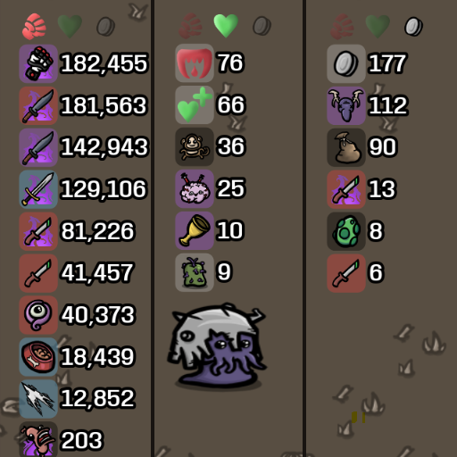

# brotato-mod-dps-meter (3358859974)
DPS meter for brotato to see damage dealt during the round.
Shows damage of weapons, characters and items sorted in descending order.
When more than 2 players are in the game, only the top 6 items of the list are shown.

A second list shows actual HP restored during the current wave, sorted in descending order.
It includes regeneration, lifesteal, consumable pickups (including healing over time),
and item healing such as medical turrets, Tentacle, and Adrenaline. Torture is listed
separately from regeneration. Hover over an icon to see its healing source.
Overhealing and blocked healing are not counted. Totals reset each wave and are
separate for each player. With more than 2 players, only the top 6 healing sources
are shown. Both lists hide shortly after the wave ends.

Both lists clear their rows when initialized, prepare known sources upfront,
and discover additional sources during the wave. Sources with zero totals are
hidden. Recorded contributions remain until the wave ends, even if the source
item or weapon is removed.

Only one list is visible per player, with damage selected at the start of each wave.
Use Q or E on the keyboard, or LB/RB (L1/R1) on a controller, to switch between
damage and healing. In co-op, each player's assigned device switches only their
own list. Switching is disabled while paused or when the meter is hidden.

## Development Notes

Follow steam guide: https://steamcommunity.com/sharedfiles/filedetails/?id=2931079751