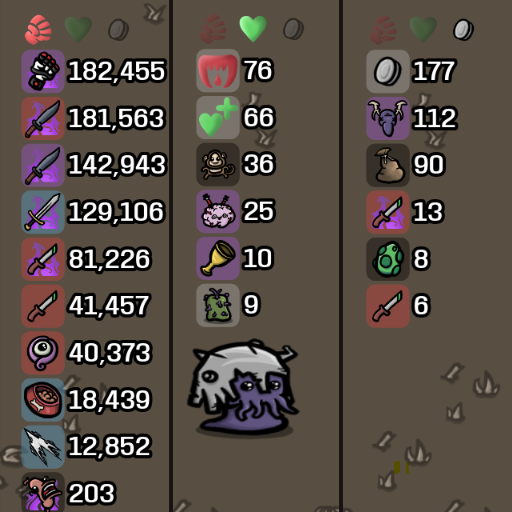

# DmgMeter (3358859974)
Per-wave Damage, Healing, and Materials Meters for Brotato.

- **Damage:** weapons, items, characters, and spawned Sources.
	Overkill Damage does not count.
- **Healing:** regeneration, lifesteal, consumables, and direct healing effects.
	Only actual HP restored counts.
- **Materials:** ground pickups, pickup bonuses, and weapon/item-generated income.
	Other income is grouped into the Other Source; spending and discounts are excluded.



Use **Q/E** or a controller's **shoulder buttons/triggers** to switch the Active Meter in each player's Meter Panel independently.

Totals are tracked per player, reset each wave, and sorted highest first.
Zero Totals are hidden; each Meter shows up to 25 Sources by default with one or two players, or six Sources with three or four players.
Material pickups follow the game's co-op sharing.
At the end of each wave, a Wave Snapshot of every Meter is available in the level-up and shop screens.

## Options

With **Oudstand-ModOptions** installed, open **Options > Mods > DmgMeter** to change options, otherwise default values will work fine.
Changes are saved automatically and apply immediately to all Meter Panels and players.

- **Wave Snapshots:** Show Wave Snapshots between rounds in the stats panel, default **enabled**
- **Percentage Bars:** Show each Source's Total relative to the highest Total in its Meter, default **disabled**.
- **Percentage Bar width during wave:** Set the HUD Percentage Bar width from **50-280 px** (capped on HP bar size), default **150 px**.
- **Sources per Meter (1-2 players):** **1-25**, default **25**.
- **Sources per Meter (3-4 players):** **1-25**, default **6**.

## Development Notes

Build the Release Package from the repo root:

```powershell
powershell -ExecutionPolicy Bypass -File .\tools\build-release.ps1
```

This creates `lrueckert-DmgMeter.zip` containing `mods-unpacked/lrueckert-DmgMeter/` with only the `.gd`, `.tscn`, `.tres`, `manifest.json` and `README.md` files.

It then opens Brotato's Steam Workshop folder (`C:\Program Files (x86)\Steam\steamapps\workshop\content\1942280`); pass `-WorkshopPath <folder>` if Steam is installed elsewhere.

Follow steam guide: https://steamcommunity.com/sharedfiles/filedetails/?id=2931079751